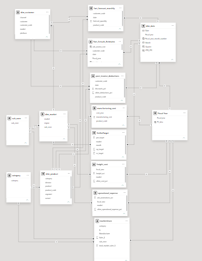
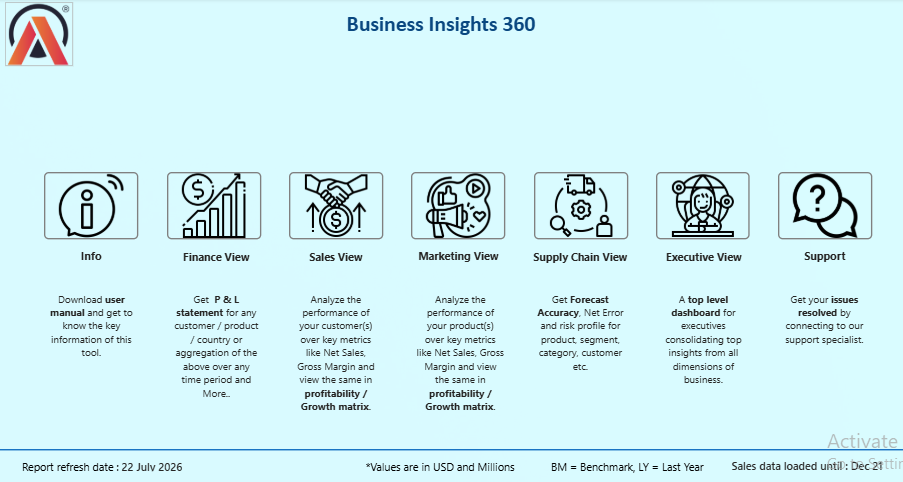
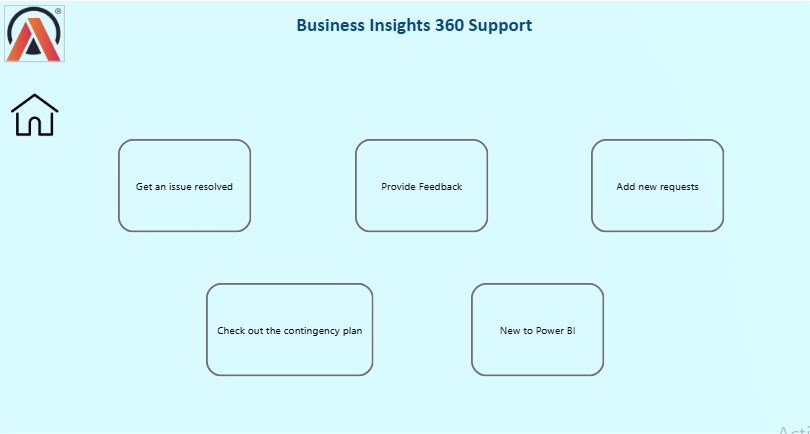
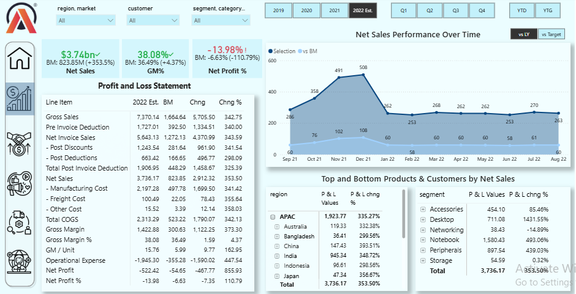
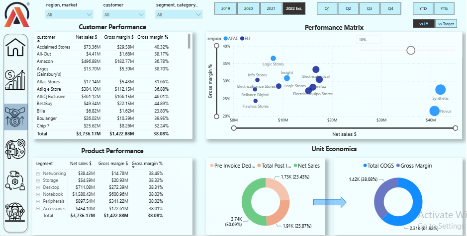
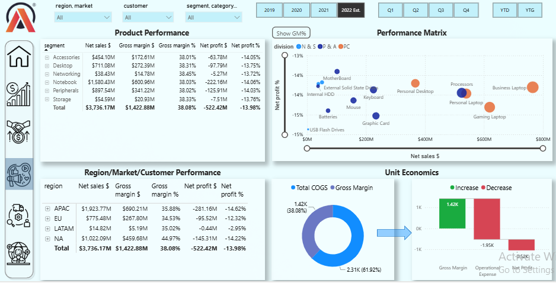
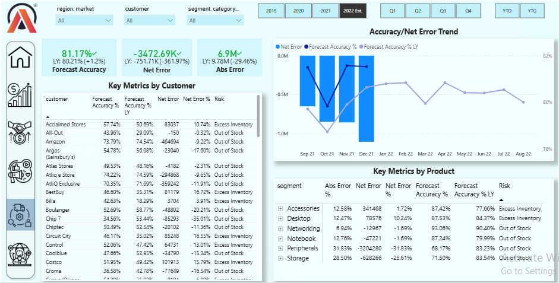
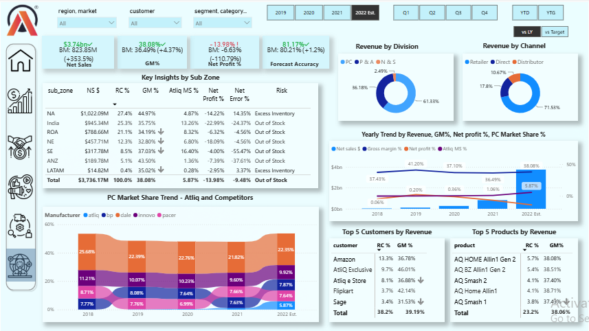

# Business Insights 360

## Project Overview

AtliQ Hardware has been growing rapidly in recent years, and they have decided to implement data analytics using Power BI in their company for the first time to surpass their competitors in the market and to make data-driven decisions. This project is hoped to give answers to the questions of stakeholders in terms of all aspects like finance, sales, marketing, and supply chain.

I worked on this project by following the Codebasics Power BI course. The link to the course is [here](https://codebasics.io/bootcamps/data-analytics-bootcamp-with-practical-job-assistance)

[Live Report Link](https://app.powerbi.com/view?r=eyJrIjoiYThkNDE3MWUtY2UyOC00YjBjLWFmNGQtZGUyNjMzYzU3YTBiIiwidCI6ImM2ZTU0OWIzLTVmNDUtNDAzMi1hYWU5LWQ0MjQ0ZGM1YjJjNCJ9)

## Tech stacks

- MySQL
- Power BI Desktop
- Excel
- DAX language
- DAX Studio (for optimizing the report)
- Project charter file

## Power BI techniques learnt

- What questions should be asked before starting the project
- Creating calculated columns
- Creating measures using DAX language
- Data modeling
- Using Bookmarks to switch between two visuals
- Page navigation with buttons
- Using the DIVIDE function to prevent zero division errors
- Creating a date table using M language
- Dynamic titles based on the applied filters
- Using KPI indicators
- Conditional formatting the values in visuals using icons or background color
- Data validation techniques
- Power BI services
- Publishing reports to Power BI services
- Setting up a personal gateway to set up the auto refresh of data
- Collaboration, workspace, access permissions in Power BI services
- And more 😅

## Business-related terms

- Gross price
- Pre-invoice deductions
- Post-Invoice deductions
- Net Invoice sale
- Gross Margin
- Net sales
- Net profit
- COGS - cost of goods sold
- YTD - Year to Date
- YTG - Year to Go
- Direct
- Retailer
- Distributors
- Consumer

## Company’s background

AltiQ Hardware has grown vastly in recent years and opened businesses all over the globe. It sells computers and accessories through three mediums/channels-

- Retailers
- Direct
- Distributors

Recently, the company has faced an unforeseen loss by opening stores in Latin America based on surveys, intuition, and some Excel analysis, and the company’s competitors also have a handful of analytics teams to perform analysis and make data-driven decisions. So, AltiQ has no other option but to build its analytics team for data-driven insights and decisions in the future to survive better in the industry. 

Project kick-off session, where you should get clear on what this project is and why, and any other questions you have regarding the project.

### Questions to ask before starting with the dashboard

- What is the objective of building this Power BI dashboard?
- In what terms will the success of this project be measured?
- What will be the deadline of the project?
- Are the stakeholders expecting a preview before the actual release?
- What are all the hopes stakeholders have out of this project?
- What are all the fears the stakeholders have in terms of building this dashboard?
- Who all will be using this dashboard and for what purpose?
- What are all the expectations the stakeholders have by the completion of this project?
- What can go wrong while building this project?
- What are all the resources/ data needed to build this dashboard?
- Are there any inputs from stakeholders in terms of design and views of the dashboard?

After the project kick-off meetings, the data engineering team has provided the data as per the request of the data analytics team; let’s explore it.

### Dataset **Understanding.**

Understanding what data is available will be more helpful when doing analysis. Before jumping into the analysis, get a good understanding of what data is available.

Dimension table: It will have static data like details of customers and products

Fact table: It will have the data about the transactions  

- gdb041:
    - dim_customer
        - **27** distinct markets (ex India, USA, Spain)
        - **75** distinct customers throughout the market
        - **2** types of platforms
            - Brick & Mortar - Physical/offline store
            - E-commerce - Online Store (Amazon, Flipkart)
        - Three channels
            - Retailer
            - Direct
            - Distributors
    - dim_market
        - **27** distinct markets (ex India, USA, Spain)
        - 7 sub-zones
        - 4 regions
            - APAC
            - EU
            - nan
            - LATAM
    - dim_product
        - Divisions
            - P & A
                - Peripherals
                - Accessories
            - PC
                - Notebook
                - Desktop
            - N & S
                - Networking
                - Storage
        - There are 14 different categories, like Internal HDD, keyboard
        - There are different variants available for the same product
    - fact_forecast_monthly
        - This table is used to forecast the customer’s needs in advance, which can help
            - Higher customer satisfaction
            - Reduced cost in warehouses for storage purposes
        - The table is denormalized by the data engineering team, as it is a data warehouse that is aimed to be used for analytical work.
        - All the dates of the month will be replaced by the start date of the month
        - It will have all the column names, and at the end it will have the forecast quantity needed by the customer
    - fact_sales_monthly
        - This table is more or less the same as the fact_forecast_monthly table, but the last column has the value of sold quantity instead of forecast value.
- gdb056
    - freight_cost
        - This table has details of travel costs and other costs for each market with fiscal year
    - gross_price
        - Has the details of gross prices with product code
    - manufacturing_cost
        - Has the details of manufacturing cost with product code and year
    - Pre_invoice_dedutions
        - Has the details of pre-invoice deductions percentage for each customer with year
    - Post_invoice_deductions
        - Post-invoice deductions and other deduction details

## Importing data into Power BI

- As the database is MySQL in this project, we need to import the datasets from the MySQL database to Power BI by providing the Database access credentials

## Data Model

- Data modeling plays a vital role and is considered the foundation of the report. All the visuals will be built upon the data model.
- Poor data modeling affects the overall performance of the report.
- Following Good practices of data modeling is a must.
- In this project, we have followed the Snowflake data modeling method.

### Dashboard designing

Based on the mockups received as requirements, the team will start designing the visuals and create measures as and when required

## Home view

In the Home view, all the view buttons will be available. The user will land on a specific view page by clicking the button 

- Info
- Finance View
- Sales View
- Marketing View
- Supply Chain View
- Executive View
- Products
- Support

## Home page

## Support Page

## Finance View

## Sales View

## Marketing View

## Supply chain View

## Executive View

You can find the full report file here : [Report](https://app.powerbi.com/view?r=eyJrIjoiYThkNDE3MWUtY2UyOC00YjBjLWFmNGQtZGUyNjMzYzU3YTBiIiwidCI6ImM2ZTU0OWIzLTVmNDUtNDAzMi1hYWU5LWQ0MjQ0ZGM1YjJjNCJ9)

## Key Insights
 
- The company’s gross sales growth YoY is close to 200% (with Last Year as BM), but it is currently loss-making.
- India is the company’s biggest market, while Notebook (Laptops) and Accessories contribute more than 50% of its sales across regions. LATAM is the least contributing region in sales and needs to be worked on.
- The company’s market share has seen improvement over the last 4 years. Grew from 0.2% in 2019 to 1% in 2021 and is forecasted at 5.87% in 2022.

## Business Impact
- The company is focusing on its growth and spending a lot on ads and marketing, increasing its operational expenses and thus currently making losses.
- The focus is on increasing market share against competitors like Dell, Lenovo, etc.
